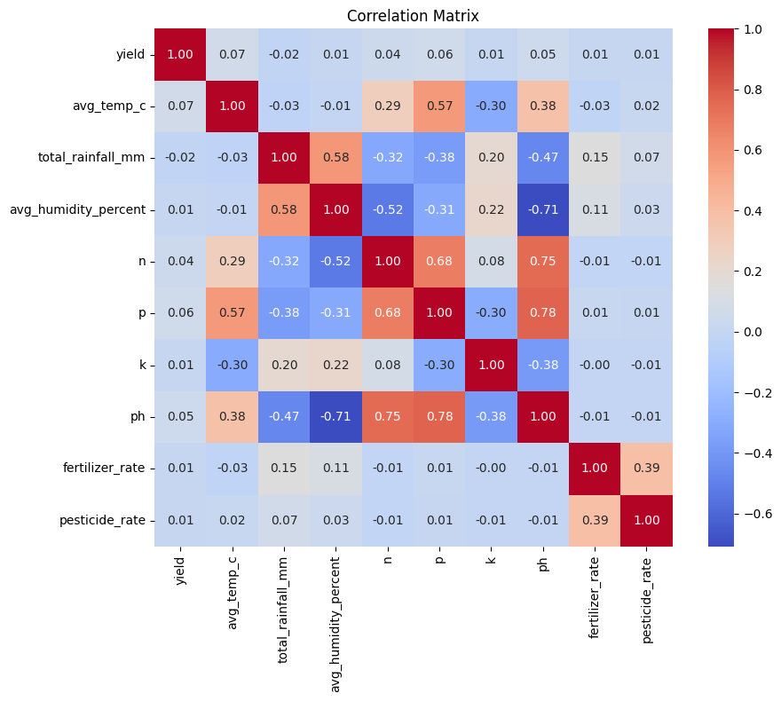
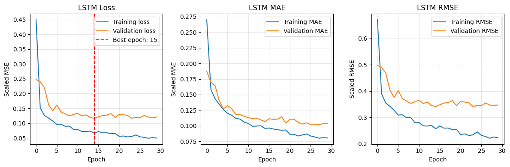
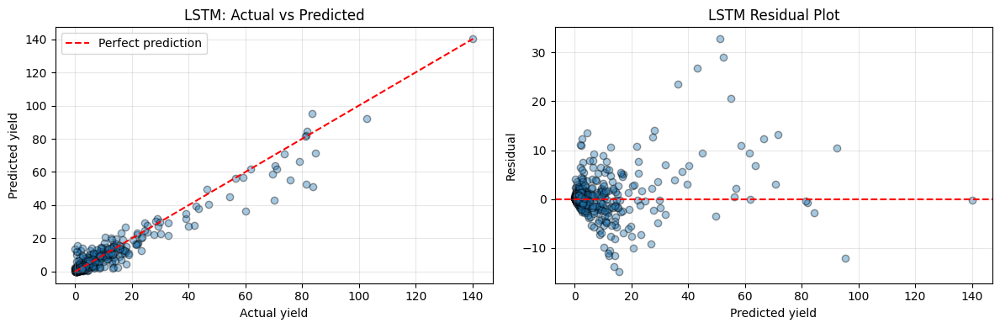

# Crop Yield Prediction with Soil and Weather Data

An exploratory machine learning project that combines Indian crop records with state-level soil and annual weather data to predict crop yield. The notebook covers data inspection, outlier handling, feature engineering, exploratory analysis, and a comparison of Linear Regression, Random Forest, XGBoost, and a stacked LSTM network.

[The Kaggle Dataset Repository Link](https://www.kaggle.com/datasets/anshumish/crop-yield-data-with-soil-and-weather-dataset/data)

The analysis starts with **19,689 crop records from 1997–2020** and produces **19,510 modeling records covering 54 crops, 30 states/territories, and six seasons** after filtering.

**Main finding:** nonlinear models improve substantially on the linear baseline. The tuned XGBoost model records the lowest RMSE among the models evaluated on the same random test split (**3.825; R² = 0.893**). The LSTM records **RMSE = 3.034 and R² = 0.937** on a separate chronological test set. These results use different evaluation designs and should not be treated as a controlled ranking across all models.

All performance values below come from the notebook's saved outputs; they have not been regenerated in a fresh training run.

## Repository contents

| File | Purpose |
| --- | --- |
| [Crop_yield_with_soil_and_weather.ipynb](Crop_yield_with_soil_and_weather.ipynb) | Complete analysis, model experiments, saved results, and plots |
| [data/crop_yield.csv](data/crop_yield.csv) | Original crop records |
| [data/state_soil_data.csv](data/state_soil_data.csv) | State-level nitrogen, phosphorus, potassium, and pH values |
| [data/state_weather_data_1997_2020.csv](data/state_weather_data_1997_2020.csv) | Annual temperature, rainfall, and humidity by state |
| [data/merged_df.csv](data/merged_df.csv) | Included merged dataset with 19,510 rows and 14 data columns, plus an exported index |
| [assets/](assets/) | Figures extracted directly from the notebook's saved outputs |

## Project objective

The project investigates how crop identity, location, season, agricultural input rates, soil properties, and weather can be used together to estimate yield. It explores two approaches:

- **Tabular regression:** predict yield from the features of an individual crop–state–season–year record.
- **Sequence modeling:** predict yield at the end of a three-observation window within the same crop–state–season series.

The notebook is an analysis and modeling study. It does not include a deployed prediction application or exported trained model.

## Data

| Dataset | Rows | Original columns | Join keys |
| --- | ---: | --- | --- |
| Crop yield | 19,689 | `crop`, `year`, `season`, `state`, `area`, `production`, `fertilizer`, `pesticide`, `yield` | Base table |
| Soil | 30 | `state`, `N`, `P`, `K`, `pH` | `state` |
| Weather | 720 | `state`, `year`, `avg_temp_c`, `total_rainfall_mm`, `avg_humidity_percent` | `state`, `year` |

The original crop data contains 55 crops. All three input files have no missing values or fully duplicated rows in the saved inspection results, and their sets of state names match. Weather covers 24 years; soil provides one set of values per state, reused across years and crops.

The notebook does not record original dataset source URLs, licenses, or complete measurement definitions. Yield values are therefore reported in the dataset's original units rather than assuming a universal unit across crops. The existing `yield` column is the prediction target; the code does not recalculate it from production and area.

## Workflow

### 1. Inspect and clean the data

The notebook checks table shapes, column types, missing values, duplicate rows, and category coverage. It standardizes column names and includes categorical cleaning that trims whitespace, lowercases values, and replaces spaces and hyphens with underscores. It also fixes the trailing space in the original `Coconut ` label.

Two rounds of yield filtering are applied:

1. **Investigate the original distribution.** The interquartile-range method flags 3,065 records, while the absolute z-score threshold of 3 flags 164 records, all belonging to coconut. The code removes **all 172 coconut records**, leaving 19,517 rows. It does not remove all IQR-flagged records.
2. **Remove remaining extreme values.** After merging and further exploration, removes **seven records with yield greater than 200**, leaving 19,510 rows.

The dataset contained 172 coconut records, representing approximately 0.87% of the original observations. Coconut had a substantially different yield scale, with an average of approximately 8,652 compared with 4.41 for the remaining crops. These values could disproportionately influence squared-error model training and pooled evaluation metrics. Coconut records were therefore excluded to focus the analysis on the remaining crops.

### 2. Merge and engineer features

Crop records are left-joined with weather on `state` and `year`, then with soil on `state`. The saved checks show no missing values after merging.

Two input-rate features are created:

```text
fertilizer_rate = fertilizer / area
pesticide_rate  = pesticide / area
```

Then removes `area`, `production`, the original fertilizer and pesticide totals, and the temporary `yield_zscore` column. Dropping production and the target-derived z-score avoids using direct target-related information as predictors; the rates express input usage relative to cultivated area.

The final tabular models use **12 input columns**:

| Feature group | Inputs |
| --- | --- |
| Crop context | `crop`, `state`, `season` |
| Weather | `avg_temp_c`, `total_rainfall_mm`, `avg_humidity_percent` |
| Soil | `n`, `p`, `k`, `ph` |
| Agricultural inputs | `fertilizer_rate`, `pesticide_rate` |

`year` is retained for analysis and chronological sequence splitting, but is excluded from the model input columns. The LSTM also excludes historical yield from its inputs.

### 3. Explore yield patterns

- **Yield remains strongly skewed after removing coconut.** The pre-second-filter summary shows a median near 1.02 and a maximum of 989.87, motivating inspection of the remaining extremes.
- **Crop averages differ substantially.** After both filters, mean yield is approximately 51.73 for sugarcane, 26.85 for banana, 16.67 for tapioca, and 0.17 for cardamom, in the recorded units. This illustrates why crop identity matters when interpreting pooled results.
- **Annual mean yield fluctuates rather than increasing steadily.** The retained records average about 3.89 in 1997, reach about 4.78 in 2013, and average about 4.42 in 2020. These are unweighted record means, affected by the mix of crops and locations represented each year.
- **Individual numeric features have weak pooled linear correlations with yield.** In the saved heatmap, yield correlations range from approximately −0.02 to 0.07. Rainfall and humidity correlate at about 0.58, while phosphorus and pH correlate at about 0.78. Weak pooled correlations do not establish that a feature has no predictive value or causal effect.

The following heatmap was generated before the seven additional extreme records were removed:



### 4. Train tabular models

The tabular experiments use an **80/20 random split**, with `random_state=25`: 15,608 training records and 3,902 test records.

Preprocessing is organized with scikit-learn pipelines and a `ColumnTransformer`:

- Numeric features: median imputation followed by standard scaling.
- Categorical features: most-frequent imputation followed by one-hot encoding, ignoring unseen categories at prediction time.

Linear Regression provides a baseline. Random Forest and XGBoost explore nonlinear relationships and interactions. The notebook also examines actual-versus-predicted plots, residuals, learning curves, and training/validation error gaps.

**Random Forest tuning:** `RandomizedSearchCV` evaluates five-fold cross-validation RMSE over 12 possible combinations. Although `n_iter=30` is requested, the saved warning confirms that all 12 combinations are evaluated. The selected configuration uses 200 trees, maximum depth 30, and a minimum of four samples per leaf, with cross-validation RMSE **3.0041**.

**XGBoost tuning:** `GridSearchCV` evaluates 18 combinations using five shuffled folds, for 90 fits. The selected configuration uses 1,500 trees, learning rate 0.03, maximum depth 5, and subsample 0.8, with cross-validation RMSE **3.0669**. Additional experiments use an internal validation split and early stopping.

### 5. Build an LSTM sequence model

The sequence experiment groups observations into **1,671 crop–state–season series**, sorts each series by year, and creates windows of three observations. Each timestep contains nine numeric features and 90 one-hot category indicators, giving **99 features**.

The saved sequence array has shape **(16,385, 3, 99)**. The target is the yield of the final observation in each window, and that year's input features are included. This is yield estimation using a short feature history, rather than a forecast made solely from information available before the target year.

Although a notebook heading calls these consecutive-year sequences, the check that rejects gaps between years is commented out. The current implementation uses three successive available observations, which may span nonconsecutive years.

| Split | Target years | Sequences |
| --- | --- | ---: |
| Training | Through 2016; earliest saved sequence target is 1999 | 13,330 |
| Validation | 2017–2018 | 1,991 |
| Test | 2019–2020 | 1,064 |

Numeric inputs and the target are standardized using training data only; one-hot inputs remain unchanged. Predictions are converted back to the original target scale before final evaluation.

The network is:

```text
Input: 3 timesteps × 99 features
→ LSTM(64, return_sequences=True)
→ Dropout(0.2)
→ LSTM(32)
→ Dropout(0.2)
→ Dense(16, ReLU)
→ Dense(1)
```

It has **54,945 trainable parameters** and uses Adam with an initial learning rate of 0.001, MSE loss, a batch size of 64, and a maximum of 100 epochs. Early stopping monitors validation loss with patience 15 and restores the best weights. A separate callback reduces the learning rate when validation loss plateaus.

The saved run stops at **epoch 30** and restores weights from **epoch 15**. Training error continues to decrease while validation error levels off, showing why validation-based stopping is useful. The curves below use standardized target units; the final test metrics use original target units.



## Saved model results

Lower MAE and RMSE are better; higher R² is better. MAE measures average absolute error, while RMSE gives greater weight to large errors. R² measures fit relative to predicting the test-set mean; it is not a percentage accuracy score.

### Shared random test split: tabular models

| Model / experiment | MAE | RMSE | R² |
| --- | ---: | ---: | ---: |
| Linear Regression | 2.7016 | 6.3681 | 0.7040 |
| Random Forest, initial 300-tree model | **0.7755** | 3.8512 | 0.8917 |
| Random Forest, tuned | 0.8515 | 3.8498 | 0.8918 |
| XGBoost, initial early-stopping model | 0.996 | 3.844 | 0.892 |
| XGBoost, best grid-search estimator | 0.889 | **3.825** | **0.893** |
| XGBoost, selected parameters with early stopping | 0.945 | 3.874 | 0.890 |
| XGBoost, final 100-tree refit | 1.678 | 4.309 | 0.864 |

### Chronological test split: sequence model

| Model | Test target years | MAE | RMSE | R² |
| --- | --- | ---: | ---: | ---: |
| Stacked LSTM | 2019–2020 | 1.261 | 3.034 | 0.937 |



## What the experiments show

1. **Nonlinear models improve on the baseline.** On the shared random split, the best grid-search XGBoost reduces RMSE by about 40% relative to Linear Regression. This is consistent with relationships that a single additive linear model does not capture well.
2. **The preferred model depends on the error measure.** Grid-search XGBoost has the lowest tabular RMSE, while the initial Random Forest has the lowest tabular MAE. A model that reduces large errors need not minimize average absolute error.
3. **Tuning offers limited gains here.** Random Forest tuning barely changes test RMSE and increases MAE. XGBoost tuning produces a modest RMSE improvement. Better cross-validation performance does not guarantee better performance on every held-out metric.
4. **The last model trained is not necessarily the best.** The final XGBoost refit uses only 100 trees and performs worse than the grid-search estimator. Its preceding early-stopping experiment omits an explicit `n_estimators` budget and reaches best iteration 99; this does not demonstrate that 100 trees is optimal under a larger search budget.
5. **The LSTM result supports further temporal experiments.** It achieves strong recorded fit on later-year targets, but its different test period, sequence eligibility rules, and sample count prevent a direct comparison with the tabular scores.
6. **Large errors remain.** The LSTM residual plot shows several substantial underpredictions and overpredictions, particularly among larger yield values. A strong aggregate R² does not mean equally reliable predictions for every crop or yield range.

## Run the notebook

The notebook was developed with Google Colab-style file paths. Its dependencies are pandas, NumPy, Matplotlib, Seaborn, SciPy, scikit-learn, XGBoost, and TensorFlow/Keras. JupyterLab can be used locally.

1. Create a Python environment. **Python 3.12 or newer is required by some existing f-string syntax**; choose an environment supported by the installed dependencies. Exact package versions are not recorded in the notebook.
2. Install the packages:

   ```bash
   python -m pip install jupyterlab pandas numpy matplotlib seaborn scipy scikit-learn xgboost tensorflow
   ```

3. Launch JupyterLab from the repository folder:

   ```bash
   python -m jupyterlab
   ```

4. Open `Crop_yield_with_soil_and_weather.ipynb` and replace with paths to the included files:

   ```python
   CROP_FILE = "./data/crop_yield.csv"
   SOIL_FILE = "./data/state_soil_data.csv"
   WEATHER_FILE = "./data/state_weather_data_1997_2020.csv"
   ```
